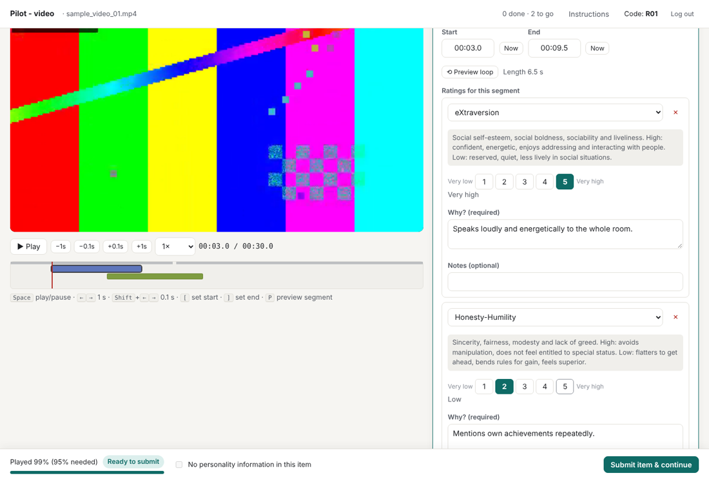
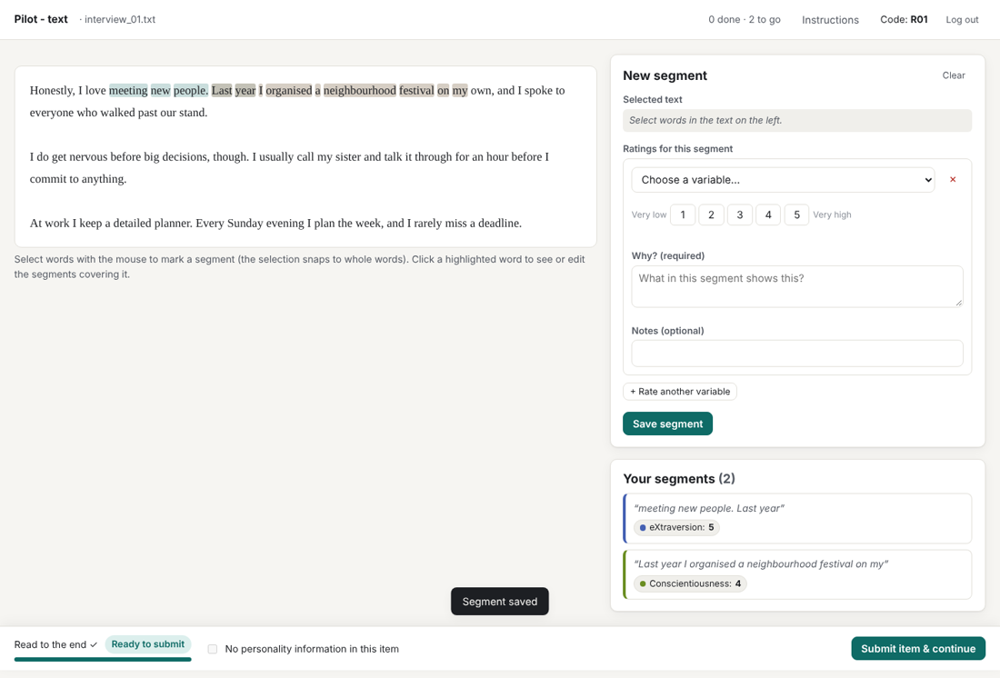
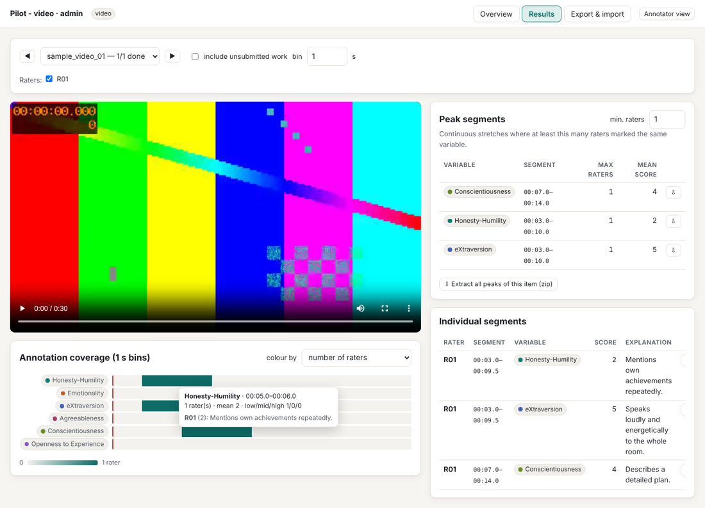

# Qualitative Personality Annotator

A free, open-source tool for **manual personality annotation of video, audio or text**.
Annotators watch, listen to or read an item, mark the segments they think reveal
personality, and rate one or more variables per segment (e.g. HEXACO domains or facets,
narcissism, depression) with a score, a written explanation and optional notes.
Researchers then see which parts of each item were marked most often, export
everything in long format, and cut the annotated segments into clips for AI training
or rater training.

This is the **pilot (local) version**: it runs on one computer and opens in the browser.
Items can come from a local folder or a public Zenodo record.



## Contents

- [Quick start](#quick-start)
- [Step-by-step: running a pilot (researcher)](#step-by-step-running-a-pilot-researcher)
- [Step-by-step: annotating (annotators)](#step-by-step-annotating-annotators)
- [Configuration](#configuration)
- [Results, exports and clips](#results-exports-and-clips)
- [Several raters on different computers](#several-raters-on-different-computers)
- [How annotations are counted](#how-annotations-are-counted)
- [Troubleshooting](#troubleshooting)
- [Limitations of this version](#limitations-of-this-version)
- [For developers](#for-developers)

## Quick start

There are two ways to run the tool. **On a university or work laptop, use Option A
(Anaconda).** Managed laptops usually block unsigned programs (see Option B).

### Option A: with Anaconda (recommended)

You need [Anaconda](https://www.anaconda.com/download) or Miniconda. Many university
laptops already have it, or offer it through the Software Center.

**The first time (installation)**

1. Get the code. Either:
   - on GitHub, click the green **Code** button → **Download ZIP**, and unzip it
     somewhere you can find it again (e.g. `Documents\qualitative-personality-annotator`); or
   - if you have git: `git clone https://github.com/Antonis-Koutsoumpis/qualitative-personality-annotator`
2. Open **Anaconda Prompt** (Windows: Start menu → *Anaconda Prompt*; macOS/Linux: a
   Terminal).
3. Go to the folder you just unzipped or cloned, for example:
   ```
   cd Documents\qualitative-personality-annotator
   ```
   (Tip: type `cd ` and drag the folder from File Explorer onto the window.)
4. Install the required packages (only needed once):
   ```
   pip install -r requirements.txt
   ```
5. Start the tool with one of the example projects:
   ```
   python -m personality_annotator --config examples/config_video.yaml
   ```
   Your browser opens at `http://127.0.0.1:8765`.

**Every time after that**

Everything is already installed, so you only need steps 2, 3 and 5:

```
cd Documents\qualitative-personality-annotator
python -m personality_annotator --config examples/config_video.yaml
```

Replace `examples/config_video.yaml` with your own config file once you have one
(see [Configuration](#configuration)). Example configs: `config_video.yaml`,
`config_audio.yaml`, `config_text.yaml` and `config_zenodo.yaml` in `examples/`.

**Stopping the tool**: click in the Anaconda Prompt window and press `Ctrl+C`
(or close the window). Everything has been saved; start it again with the commands
above to continue.

**Updating to a newer version**: download the ZIP again (or run `git pull` in the
folder) and run `pip install -r requirements.txt` once more. Keep your own
`config.yaml` and the `annotation_data` folder; they hold your settings and data.

Optional: to keep the tool's packages separate from your other projects, create a
conda environment once with `conda create -n annotator python=3.12` and
`conda activate annotator` before step 4, and run `conda activate annotator` each time
before starting the tool.

### Option B: the ready-made program (no Python needed)

1. Go to the **Actions** tab of this repository, open the latest successful
   *test-and-build* run and download the zip for your system
   (`PersonalityAnnotator-windows`, `-macos` or `-linux`). Tagged versions also appear
   under **Releases**.
2. Unzip it. The folder contains the program, a `config.yaml` and `sample_data`.
3. Start `PersonalityAnnotator` (on Windows: `PersonalityAnnotator.exe`). A console
   window opens and your browser shows the tool at `http://127.0.0.1:8765`.
   Keep the console window open while you work; closing it stops the tool.

The program is not code-signed, so your system will warn you the first time:

- **Windows (personal computer)**: "Windows protected your PC" → *More info* →
  *Run anyway*.
- **Windows (university/work laptop)**: if the only button is *Don't run*, your
  organisation's policy blocks unsigned programs. Use Option A, or ask your IT
  department to allow the program.
- **macOS**: right-click the program → *Open* → *Open*. If macOS still refuses, run
  `xattr -d com.apple.quarantine PersonalityAnnotator` in Terminal in that folder.
  You may also need `chmod +x PersonalityAnnotator`.

### The two pages

| Page | Address | Who uses it |
|---|---|---|
| Annotator page | `http://127.0.0.1:8765/` | annotators |
| Admin page | `http://127.0.0.1:8765/admin` | the researcher |

If port 8765 is busy, the tool picks the next free one; the address is printed in the
Anaconda Prompt / console window. Other options: `--port 8765`, `--no-browser`, and
`--host 0.0.0.0` (lets other computers on the same network reach the tool, for
supervised sessions where several annotators share one computer's database).

To password-protect the admin page, set the environment variable
`ANNOTATOR_ADMIN_PASSWORD` before starting the tool (Anaconda Prompt on Windows:
`set ANNOTATOR_ADMIN_PASSWORD=yourpassword`; macOS/Linux: `export ...`).

## Step-by-step: running a pilot (researcher)

1. **Try it with the sample items.** Start the tool with
   `examples/config_video.yaml` and annotate as a test user (see the next section).
   The sample videos are synthetic test patterns, so you can mark anything.
2. **Make your own project.** Copy `personality_annotator/config.example.yaml` to a new
   file, e.g. `my_pilot.yaml`, in the main folder and edit it in any text editor:
   - `modality`: `video`, `audio` or `text`;
   - `sources`: the folder with your files, or your Zenodo link;
   - `variables`: what annotators may rate (HEXACO domains are filled in; facet and
     other examples are included as comments);
   - `annotators_per_item`: how many raters each item needs.
   Then start the tool with `--config my_pilot.yaml`.
3. **Check the items arrived.** Open the admin page → *Overview*. Under *Sources* you
   see how many files were found and any errors (e.g. a wrong folder path). The
   *Items* table lists them. After adding files, click *Re-scan sources*.
4. **Hand out participant codes.** A participant code is just a short label you give
   each annotator, e.g. `R01`, `R02`. There is no account or password: whoever types
   a code works as that annotator. Keep a list of who has which code; avoid names or
   e-mail addresses.
5. **Let annotators work** on the annotator page (on this computer, or see
   [Several raters on different computers](#several-raters-on-different-computers)).
   *Overview* shows how many items each annotator has completed.
6. **Look at the results** in the *Results* tab and **download** the tables and clips in
   the *Export & import* tab (see [Results, exports and clips](#results-exports-and-clips)).

Your data are stored in the `data_dir` folder named in the config (by default
`annotation_data` next to the config file). Back it up, or download a full export
from the admin page, before deleting or moving anything.

## Step-by-step: annotating (annotators)

**Signing in**

1. Open the annotator page (the browser usually opens it automatically).
2. Type the **participant code** your researcher gave you (for a test, any code such as
   `TEST01`) and click *Continue*.
3. The first time you use a code, you are asked for your **age** and **gender**; then
   click *Start*. Next time, the same code takes you straight back to where you were.

**The annotation screen**

- **Top bar**: the item's name, how many items you have done and how many remain, the
  *Instructions* button (definitions of all variables and the rating scale), your code
  and *Log out*.
- **Left**: the video, audio (with waveform) or text, with play controls, the playback
  speed and a timeline. On the timeline, the grey line shows what you have played and
  coloured bars are your segments.
- **Right, top: the segment editor**, where you create or edit a segment.
- **Right, bottom: Your segments**, a list of what you have marked. Click one to jump
  to it and edit or delete it.
- **Bottom bar**: your progress through the item, the *No personality information*
  box and the *Submit* button.

**Marking a segment (video/audio)**

1. Play the item. When you notice something that says something about the person's
   personality, press `[` (or *Now* next to *Start*) at the beginning of the moment
   and `]` (or *Now* next to *End*) at its end. You can also type times as `mm:ss.s`,
   and for audio drag across the waveform.
2. Click *Preview loop* (or press `P`) to check the segment; click it again to stop.
3. Under *Ratings for this segment*, choose a **variable**, click a **score**, and
   write **why** (required). *Notes* are optional.
4. If the segment says something about another variable too, click
   *+ Rate another variable*. Use ✕ to remove a rating.
5. Click **Save segment**. It appears in *Your segments* and on the timeline.

**Marking a segment (text)**

1. Select words with the mouse. The selection is extended to whole words and shown
   in the editor under *Selected text*.
2. Rate it as above and click **Save segment**. Marked words are shaded; darker shading
   means several of your segments overlap there. Click a shaded word to open the
   segments covering it.

**Editing**: click a segment in *Your segments* (or on the timeline/waveform/text),
change it, and click *Update segment*, or *Delete segment*. *Clear* empties the editor.

**Finishing an item**

- Play the whole item (at least 95 % by default; you may rewind and rewatch) or, for
  text, scroll to the end. The bar at the bottom shows how far you are.
- If the item contains no personality information at all, tick
  *No personality information in this item* and explain why.
- Click **Submit item & continue**. A submitted item can no longer be changed, and
  the next item opens. When there are none left, you see *All done*.

You can stop at any time by closing the browser tab: saved segments are kept, and an
unsaved half-filled form is restored when you return with the same code.

**Keyboard shortcuts** (when you are not typing in a field): `Space` play/pause ·
`←`/`→` 1 s · `Shift`+`←`/`→` 0.1 s · `[` set start · `]` set end · `P` preview.

Annotators only ever see their own annotations. Items come one at a time in random
order; nobody gets the same item twice, and items with the fewest annotations are
offered first so that annotations stay evenly spread.



## Configuration

Everything is set in `config.yaml` (fully commented; see
[`personality_annotator/config.example.yaml`](personality_annotator/config.example.yaml)).
Restart the tool after editing it.

| Setting | Meaning |
|---|---|
| `modality` | `video`, `audio` or `text`; one modality per project |
| `sources` | where items come from (see below); several sources may be combined |
| `annotators_per_item` | how many different annotators should rate each item |
| `scale` | one rating scale for all variables (default 1–5) with labels |
| `variables` | what can be rated: `id`, `label`, `group` (for menus) and a `definition` shown to annotators |
| `completion` | share of a video/audio that must actually be played before submitting (default 95 %); for text, scrolling to the end and an optional minimum reading time |
| `coverage_bin_s` | time-bin size for counting overlap in video/audio (default 1 s) |
| `reservation_timeout_h` | an item opened but not finished is released for others after this time |
| `demographics` | age range and gender options asked on first login |
| `instructions` | text shown on the annotators' *Instructions* panel |
| `data_dir` | where the database, caches and temporary files are kept |

### Item sources

```yaml
sources:
  - type: local                 # a folder on this computer
    path: ./my_videos
    recursive: false            # also scan sub-folders
    pattern: "*.mp4"            # optional filter

  - type: zenodo                # a public Zenodo record
    record: https://zenodo.org/records/1234567   # link, DOI or record number
    pattern: "*.mp4"

  - type: text_csv              # text only: one row per text
    path: ./transcripts.csv     # or url: https://...
    id_column: item_id
    text_column: text
```

Supported files: video `.mp4 .webm .m4v .mov .ogv`; audio
`.mp3 .wav .m4a .ogg .flac .aac .opus`; text `.txt .md`. Use MP4 (H.264/AAC) for video;
it plays in every browser.

The item id is the file name without extension. Items are scanned at start-up and with
**Re-scan sources** on the admin page. Files that disappear are hidden, never deleted,
and their annotations are kept.

Zenodo files are streamed through the tool, so seeking works. Set `cache_media: true`
to download each file once into `data_dir/media_cache` instead. Note that a Zenodo
record holds at most 100 files, so larger collections need several records.

## Results, exports and clips

The **admin page** has three tabs:

- **Overview**: progress per item (completed vs. target) and per annotator, the
  sources and any scan errors, and the explanations given for "no personality
  information".
- **Results**: per item, a heatmap of how many raters marked each moment (or each word)
  for each variable. You can colour it by the number of raters or by the mean score
  (low ↔ high), filter by rater, and hover for scores and explanations. Clicking the
  heatmap jumps the player to that moment. There is a table of **peak segments**
  (continuous stretches marked by at least *n* raters) and of all individual
  segments; each can be downloaded as a clip.
- **Export & import**: CSV downloads, extraction of all peaks, and full backups.



### Exported tables (long format, UTF-8 CSV)

| File | One row per | Key columns |
|---|---|---|
| `annotations_long.csv` | rating | `annotator_code`, `item_id`, `segment_id`, `start_s`, `end_s` (video/audio) or `char_start`, `char_end`, `span_text` (text), `variable`, `score`, `explanation`, `notes`, timestamps, `instance_id` |
| `coverage_long.csv` | item × variable × time bin (or word) | `n_annotators`, `mean_score`, `sd_score`, `n_low`/`n_mid`/`n_high` (relative to the scale midpoint), `annotators` |
| `peak_segments.csv` | stretch with ≥ *n* raters | `start_s`/`end_s` (or `start_char`/`end_char` + `span_text`), `max_n_annotators`, `mean_score`, `n_ratings`, `annotators` |
| `assignments.csv` | annotator × item | status, watched proportion / reading time, no-information flag and explanation |
| `annotators.csv` | annotator | code, age, gender |

By default only **submitted** items are included; tick *include unsubmitted work* to
see work in progress. In `coverage_long.csv`, bins or words nobody marked are left out
unless you tick *include empty bins / words*.

Every row carries the `annotator_code`, so raters are always distinguishable. The
`instance_id` additionally identifies the computer (database) a rating was made on.

### Clips

Downloads are zip files. Each segment comes as a clip (`.mp4` for video, the original
audio format for audio, `.txt` for text) plus a `.json` and a `.csv` with its ratings,
and an `index.csv` lists everything. Video is re-encoded for frame-accurate cuts.

For large batches, or with the material on another computer, use the command-line
script on exported CSVs:

```bash
# one clip per annotator segment
python tools/extract_segments.py --csv annotations_long.csv --media-dir ./videos --out ./clips
# one clip per peak, with the overlapping ratings
python tools/extract_segments.py --csv peak_segments.csv --annotations annotations_long.csv \
    --media-dir ./videos --out ./peak_clips --min-raters 2
```

## Several raters on different computers

In this version each computer has its own database, so live assignment across laptops
isn't possible. To combine raters:

1. Each rater (or you, on their computer) opens the admin page → *Export & import* →
   **Download full export** (`full_export.json`).
2. On your computer, **Import a full export…** for each file.

All ids are unique across computers, so nothing collides and importing the same file
twice adds nothing. The results view and all exports then include every rater.
Make sure raters use **different participant codes**; the import warns if the same
code rated the same item on two computers. For text, the import also checks that both
computers used identical text, so character positions match.

On separate computers, each rater works through every item their computer's sources
contain (`annotators_per_item` only applies within one database). To split the work,
point each computer at a different folder or Zenodo `pattern`; to have everyone rate
everything, give them all the same sources.

Several annotators can also share **one** database during a supervised session: start
the tool with `--host 0.0.0.0` and let them open `http://<that computer's IP>:8765`.
Then the assignment rules (no repeats, even spread, `annotators_per_item`) apply
across all of them.

## How annotations are counted

- Video/audio time is divided into bins (default 1 s). A rating covers every bin its
  segment overlaps.
- Text is divided into words; a rating covers every word its span overlaps.
- Per bin/word and variable, each annotator counts **once**. If one annotator has
  several overlapping segments rated on the same variable, their scores are averaged
  for that bin.
- `n_low`, `n_mid` and `n_high` count annotators whose (averaged) score is below, at or
  above the scale midpoint, so "often marked as high" and "often marked as low" can be
  separated.
- Peak segments merge consecutive bins/words that reach the threshold. For video/audio,
  their edges are tightened to where the overlapping annotations actually start and
  end.

## Troubleshooting

| Problem | What to do |
|---|---|
| `'python' is not recognized` / `pip` not found | Use **Anaconda Prompt**, not the normal Command Prompt. |
| `No module named personality_annotator` | You are not in the tool's folder: `cd` into it first (the folder that contains `README.md`). |
| `No module named fastapi` (or another package) | Run `pip install -r requirements.txt` again in the tool's folder. |
| The browser doesn't open | Copy the address printed in the Anaconda Prompt (e.g. `http://127.0.0.1:8765/`) into your browser. |
| *Overview* shows 0 items or an error under *Sources* | Check the `path` or Zenodo link in your config, then click *Re-scan sources*. Relative paths are relative to the config file's folder. |
| A video doesn't play | Use MP4 (H.264 video, AAC audio). Other formats may not play in every browser. |
| The annotator page says *All done* immediately | Every item already has enough annotators or was done by this code. Check *Overview*, or raise `annotators_per_item`. |
| "Problem in config.yaml" when starting | The message names the setting; YAML is sensitive to indentation (use spaces, not tabs). |
| Windows: *Don't run* is the only option for the .exe | Your organisation blocks unsigned programs; use [Option A](#option-a-with-anaconda-recommended). |

## Limitations of this version

- Local only: no central server, no live synchronisation between computers (use full
  export/import).
- Sources: local folders and public Zenodo records. OSF, Yoda (WebDAV) and other
  private storage are planned; the source code is structured so they can be added in
  `personality_annotator/sources.py`.
- One shared rating scale for all variables.
- The admin page is open to anyone who can reach the tool unless
  `ANNOTATOR_ADMIN_PASSWORD` is set. Annotator logins are by code only. This is
  fine on one computer but not meant for public internet hosting.
- The downloadable programs are not code-signed (see the warnings above).

## For developers

```
personality_annotator/
  __main__.py      start-up (python -m personality_annotator)
  app.py           FastAPI app: annotator API, admin API, media streaming
  config.py        config.yaml loading and validation
  db.py            SQLite schema (UUID ids, audit log of every change)
  sources.py       local / Zenodo / text_csv sources, syncing items
  assignment.py    which item an annotator gets next
  analysis.py      coverage and peak computation (pure Python)
  exports.py       CSV/JSON exports, importing another computer's export
  extract.py       ffmpeg cutting and zip bundling
  static/          HTML/CSS/JS front-end (wavesurfer.js vendored, BSD-3)
tools/
  make_sample_data.py   synthetic videos/audio/texts for testing
  extract_segments.py   command-line extraction from exported CSVs
tests/                  pytest suite (assignment rules, coverage, exports, merging)
```

```bash
pip install -r requirements-dev.txt
python tools/make_sample_data.py
pytest -q
```

GitHub Actions (`.github/workflows/build.yml`) runs the tests and builds the Windows,
macOS and Linux programs with PyInstaller on every push to `main`. Push a tag such as
`v0.1.0` to publish them as a release.

## Licence

MIT. wavesurfer.js is included under its BSD-3-Clause licence
(`personality_annotator/static/vendor/wavesurfer-LICENSE.txt`).
